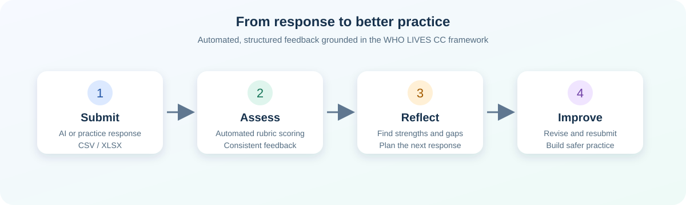
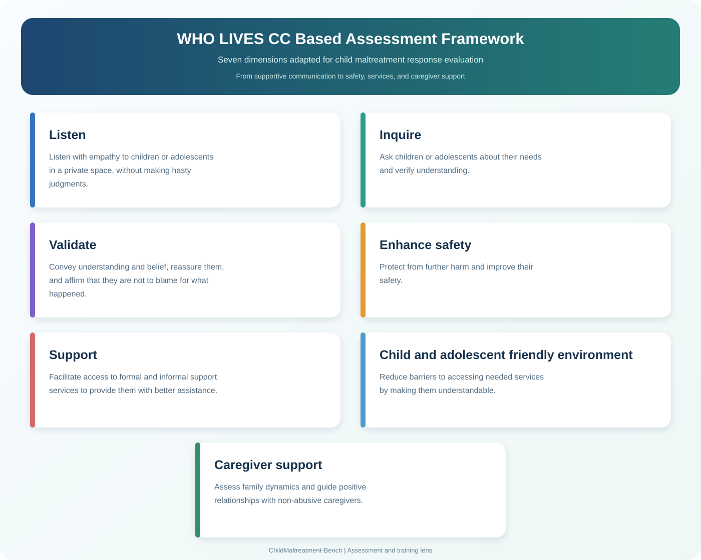

# ChildMaltreatment-Bench

An agent-compatible tool that scores child-maltreatment responses automatically and turns missing skills into practical feedback for AI evaluation, research, and social-work training.



ChildMaltreatment-Bench helps users answer a simple question: **What is good about this response, what is missing, and how can the next response be better?** It converts an expert-informed WHO LIVES CC-based assessment framework into a repeatable workflow for response review and practice.

## WHO LIVES CC Framework at a Glance

The WHO LIVES CC framework is an authoritative, evidence-informed approach to first-line support for people disclosing violence. It is widely used in global health guidance and training to organize compassionate listening, needs-focused inquiry, validation, safety planning, and connection to support. This study uses the framework as the foundation for an adapted assessment standard for AI-mediated responses to child maltreatment, extending it with child- and adolescent-friendly communication and caregiver support.

The framework definitions below are adapted directly from the project's content-analysis codebook:



The image presents the framework at a conceptual level. See the [detailed assessment rubric](./references/rubric.md) for the operational scoring rules.

## Scientific Basis and Calibration

The scoring system was developed from approximately 8,400 human-scored responses. These expert-coded data were used as the foundation for training, validation, error analysis, and calibration against the 14 assessment criteria. After validation and refinement, the resulting program translates the human scoring standard into a reproducible automated workflow for large-scale response assessment.

This evidence-informed process improves scoring consistency and efficiency while preserving the role of human review. The automated output is intended to support research coding, pre-annotation, supervision, and social-work skills practice; it does not replace professional judgment or safeguarding procedures.

## Why Use It

- **For AI teams:** compare many model responses consistently.
- **For researchers:** export structured results for analysis.
- **For social workers:** practice a response, receive feedback, revise it, and repeat.
- **For trainers:** use the same criteria for supervision and reflective learning.

The system evaluates qualities such as empathy, safety awareness, appropriate support, child-friendly communication, and attention to non-abusive caregivers. It supports learning and supervision; it does not replace professional judgment, safeguarding procedures, clinical assessment, or emergency services.

## Quick Start

There are two ways to use the package.

### Option A: Use it with an AI agent

For an agent that supports local skills or the Agent Skills format, make the package available to the agent and ask:

```text
Use the ChildMaltreatment-Bench skill to score responses.csv and return an analysis-ready CSV.
```

Agents that support explicit skill syntax may also use:

```text
Use $childmaltreatment-bench to score responses.csv.
```

Other agents can follow the same workflow by loading this package's `SKILL.md` and running the bundled script. The package is not limited to Codex.

### Option B: Run it from the command line

1. Prepare a CSV, XLSX, or XLS file. Only the response-text column is required; age, gender, location, model name, question ID, and record ID are optional.

   A minimal CSV is:

   ```csv
   answer
   I am sorry this happened. Are you safe right now? We can think about who you trust and what support you need.
   ```

   The tool recognizes `answer`, `response`, `text`, `回答`, `文本答案`, and `答案`. For another column name, use `--text-column`.

2. Install Excel dependencies only when needed:

   ```bash
   pip install -r requirements.txt
   ```

3. Run:

   ```bash
   python scripts/score_responses.py --output-dir outputs input.csv
   ```

4. Find the result at `outputs/input_scored.csv`. Existing results are preserved as `_2`, `_3`, and so on. The long answer text is removed from the analysis output by default.

For a headerless file, the file must contain exactly seven columns in this order: `record_id, model, question_id, age, gender, location, answer`. Run:

```bash
python scripts/score_responses.py \
  --output-dir outputs \
  --auto-headerless-standard-format \
  headerless_input.csv
```

If a file contains only response text and has no age or gender fields, add a header such as `answer` before scoring. A headerless one-column file is not treated as the seven-column standard format.

For an Excel sheet named `Result 1`, add `--sheet-name "Result 1"` before the input path.

## What You Receive

The output CSV keeps all metadata supplied in the input and adds structured assessment results. It is suitable for model comparison, supervision notes, and statistical analysis. Detailed label definitions are kept in the [detailed assessment rubric](./references/rubric.md) rather than in this project overview.

## Compatibility

The package can be used in two layers:

- **Agent layer:** any agent that can read `SKILL.md`, access the package files, and run local commands can use the workflow. `$childmaltreatment-bench` is only one explicit invocation style.
- **Standalone layer:** the bundled Python script can run independently of an AI agent.

The bundled model runs locally and does not call an external scoring API.

## Authors

1. Xuetong Wang
2. Gaoran Chen
3. Guowei Wan
4. Yiwei Qiu

East China Normal University

## Project Files

```text
childmaltreatment-bench/
├── SKILL.md
├── README.md
├── requirements.txt
├── agents/openai.yaml
├── assets/
│   ├── grader_model.pkl.gz
│   ├── lives-cc-framework.svg
│   └── workflow.svg
├── references/rubric.md
└── scripts/
    ├── score_responses.py
    └── ai_grader/
```
